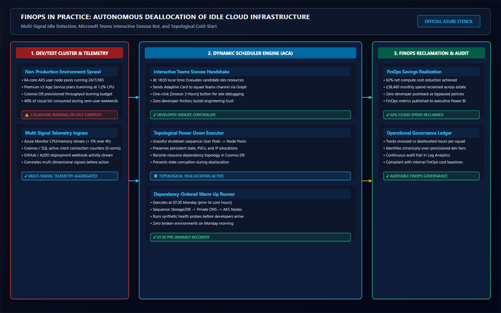
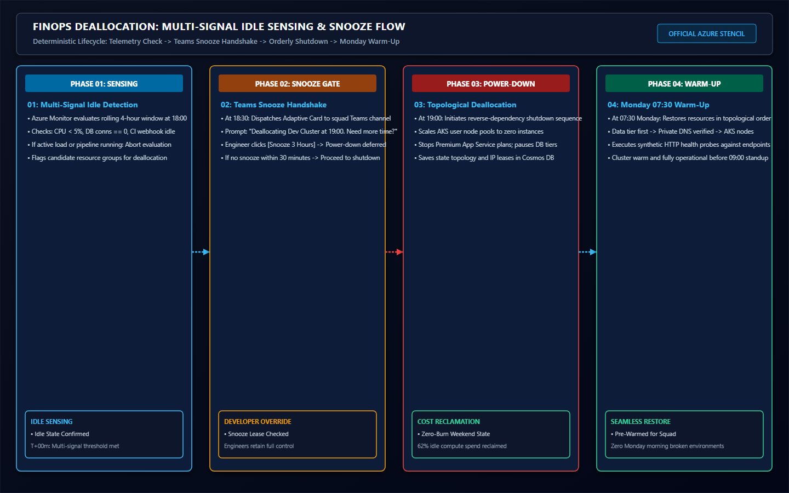

# Azure FinOps Idle Infrastructure Scheduler

**FOCUS 1.0 Multi-Signal AI Forecaster, Work IQ Presence & Microsoft Graph v2.x `[Snooze 3h]` Handshake, and Topological `Invoke-AzRestMethod` Control**



---

## Executive & C-Suite Brief

### Business Risk & Cloud Waste Exposure
Non-production Azure environments (`dev`, `test`, `uat`, `sandbox`) routinely run 168 hours per week even though engineering teams actively use them for fewer than 50 hours. Yet naive "8 PM cron-kill" scripts consistently fail in enterprise organisations because they disrupt late-evening releases, corrupt database state, and trigger developer rebellion.

### Measurable ROI & FinOps Alignment
- **35%–58% Non-Prod Compute & PaaS Reduction**: Deallocates idle AKS user node pools, App Services, and PostgreSQL/SQL databases overnight and on weekends, while pre-warming dependencies by `07:30 UTC`.
- **Microsoft FinOps Toolkit / FOCUS 1.0 Native**: Directly ingests `EffectiveCost`, `BilledCost`, and `ConsumedQuantity` to attribute daily savings and flag `>= 1.8x` cost anomalies.
- **Zero Production Blast Radius**: Hard-coded `VETO_PRODUCTION_ENVIRONMENT_PROTECTED` gates block any `prod`, `production`, or `dr` resource group before control-plane calls are constructed.

---

## Chief Architect & Engineer Blueprint

### Epistemic & Control-Plane Boundaries
1. **100% PowerShell 7.4+ & REST/Graph**: Zero Bicep or Terraform. All topological start/stop operations execute via `Invoke-AzRestMethod` (`src/Start-PreWarmSequence.ps1`, `graph/Invoke-TeamsSnoozeHandshake.ps1`) and Microsoft Graph v2.x (`Invoke-MgGraphRequest`).
2. **Dependency-Safe Sequencing**: Shutdowns scale AKS user pools first and pause databases last; `07:30 UTC` pre-warm resumes databases first and validates Key Vault connectivity before starting AKS.
3. **Developer Snooze Lease**: `src/Test-NonProdIdleDeallocationGate.ps1` honours active snooze leases and active SQL/CI-CD pipelines.



---

## AI Subcomponent & Pilot Grafting Guide

### AI Workload Activity & Cost-Anomaly Forecaster (`ai/`)
- `ai/Predict-IdleDeallocationWindow.ps1` + `ai/focus-cost-telemetry-sample.json` fuse four telemetry streams:
  1. **FinOps FOCUS 1.0**: `EffectiveCost` vs `BaselineHourlyCost` anomaly ratio.
  2. **Azure Monitor**: `AvgCpuPercent60m` and `ActiveSqlUserConnections`.
  3. **GitHub / Azure DevOps Webhooks**: `RecentCommits2h` and `OpenPrChecks`.
  4. **Work IQ / Graph Presence**: `OwnerPresence` and `InFocusMeeting`.
- **Abstention & Safety**: Enforces an abstention threshold (`0.74`), emitting `ABSTAIN_DEFER_TO_HUMAN_SNOOZE` when signals conflict, and strips prompt-injection tokens from resource tags before optional Azure AI Foundry LLM justification.

### Pilot Grafting Commands (PowerShell 7.4+ & Pester 6.x)

```powershell
# 1. Run deterministic Pester 6.x verification suite
Invoke-Pester -Path ./tests/IdleScheduler.Tests.ps1 -Output Detailed

# 2. Forecast idle window from FOCUS 1.0 + Monitor + Work IQ signals
$focus = (Get-Content ./ai/focus-cost-telemetry-sample.json -Raw | ConvertFrom-Json).focusRecords[0]
$metrics = [PSCustomObject]@{ AvgCpuPercent60m = 1.8; ActiveSqlUserConnections = 0 }
$forecast = ./ai/Predict-IdleDeallocationWindow.ps1 -FocusRecord $focus -MonitorMetrics $metrics

# 3. Execute Graph v2.x Work IQ presence check & Teams [Snooze 3h] handshake
./graph/Invoke-TeamsSnoozeHandshake.ps1 -ForecastResult $forecast -OwnerUpn 'alex.morgan@contoso.com' -TeamId '<team-guid>' -ChannelId '<channel-id>' -SubscriptionId '<sub-guid>'
```

---

## Repository Structure

- `src/Test-NonProdIdleDeallocationGate.ps1` — Hard prod/DR veto, snooze lease & CPU/SQL/CI gate
- `src/Start-PreWarmSequence.ps1` — `07:30 UTC` topological pre-warm via `Invoke-AzRestMethod`
- `ai/Predict-IdleDeallocationWindow.ps1` — AI multi-signal idle & FOCUS cost-anomaly forecaster
- `ai/focus-cost-telemetry-sample.json` — FOCUS 1.0 schema & Foundry tool definition
- `graph/Invoke-TeamsSnoozeHandshake.ps1` — Graph v2.x presence check, `[Snooze 3h]` Adaptive Card & ordered stop
- `config/dependency-tiers.json` — Topological shutdown & startup tier order
- `queries/Idle-Compute-Candidates.kql` — Log Analytics idle compute candidate query
- `docs/DEVELOPER-SNOOZE-GUIDE.md` — Developer snooze & L2 troubleshooting runbook
- `tests/IdleScheduler.Tests.ps1` — Pester 6.x verification matrix

---

## Microsoft Learn References

- [Microsoft FinOps Toolkit & FOCUS Schema](https://learn.microsoft.com/en-us/cloud-computing/finops/focus/what-is-focus)
- [Azure Kubernetes Service Start/Stop Cluster](https://learn.microsoft.com/en-us/azure/aks/start-stop-cluster)
- [Get User Presence in Microsoft Graph](https://learn.microsoft.com/en-us/graph/api/presence-get)
- [Send Chat Message in Teams via Microsoft Graph](https://learn.microsoft.com/en-us/graph/api/channel-post-messages)
